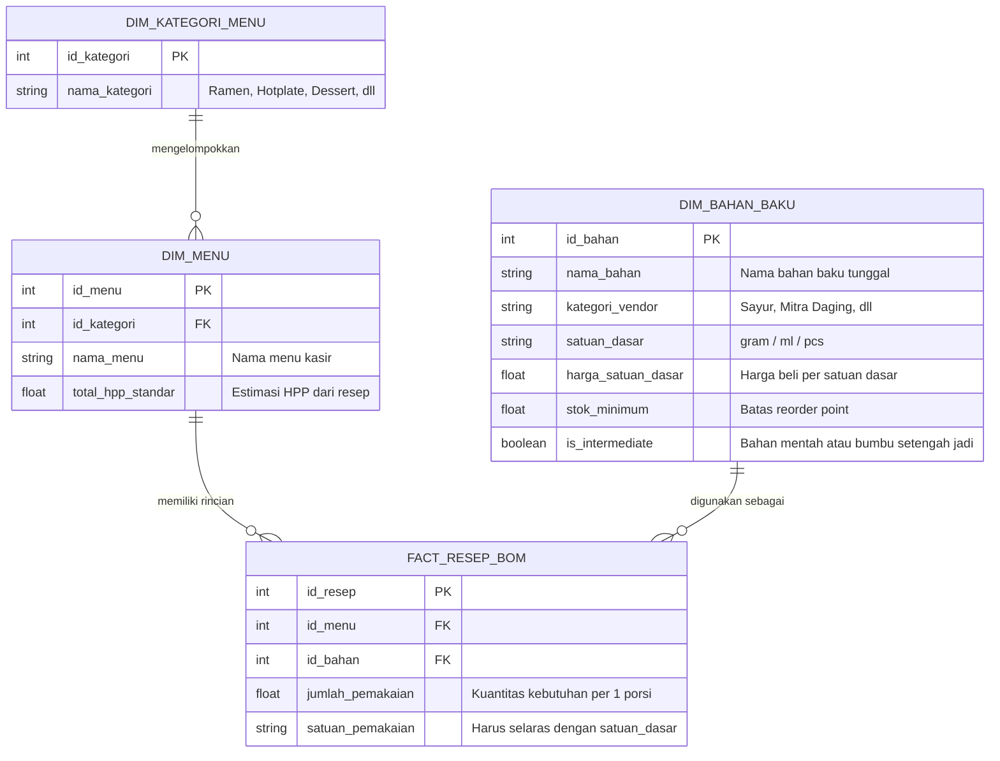
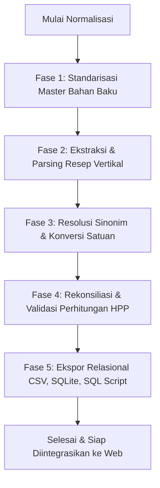
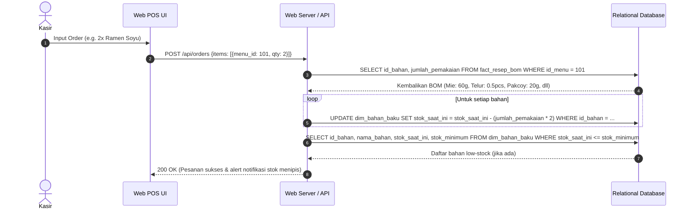

# 📋 Rencana Aksi: Normalisasi Data Bahan Makanan & Resep (BOM)
### Sistem Manajemen Stok Terintegrasi Kasir (Ale's Place Resto)

---

## 1. Ringkasan & Tujuan Proyek

Proyek ini bertujuan mentransformasikan kumpulan lembar resep dan inventaris mentah yang tidak terstruktur ([Data Bahan Makanan](file:///d:/0.%20Dokumen%20Kuliah/Semester%205/0.%20Project%20Capstone/Data%20Bahan%20Makanan)) menjadi **basis data relasional terstandarisasi (3NF)**.

Data ini akan menjadi *engine* utama di backend aplikasi web untuk menjalankan fitur:
> **Automatic Stock Depletion (Pengurangan Stok Otomatis)**:  
> Ketika kasir menginput pesanan makanan, backend web secara otomatis mengonversi menu tersebut ke daftar bahan baku berdasarkan resep (*Bill of Materials*) dan langsung memotong saldo kuantitas stok di gudang secara *real-time*.

---

## 2. Analisis Kondisi Data Mentah (*As-Is*)

Berdasarkan audit awal terhadap 9 file CSV bahan makanan, ditemukan beberapa karakteristik yang harus dinormalisasi:

| Karakteristik | Kondisi Mentah | Dampak ke Sistem | Solusi Normalisasi |
| :--- | :--- | :--- | :--- |
| **Format Lembar Kerja** | Format vertikal Excel (judul menu di baris 1, tabel bahan di baris bawahnya, diakhiri baris `TOTAL`) | Tidak bisa langsung di-query dengan SQL / pandas | Parser berbasis blok (deteksi boundary menu $\rightarrow$ bahan $\rightarrow$ total) |
| **Kamus Bahan Baku** | Terdapat di `DATA BASE.csv` tapi ada 33 bahan di resep yang tidak terdaftar di database | Relasi *Foreign Key* bisa putus | Penggabungan kamus bahan baku terpadu (*Master Ingredients*) |
| **Sinonim & Typos** | Variasi penulisan nama (e.g. `TIMUN` vs `MENTIMUN`, `ES` vs `ES BATU`, `PAKCOY` vs `PAKCOY HIDROFONIK`) | Stok bahan yang sama terpecah menjadi dua | Mapping kamus kanonikal (*alias dictionary*) |
| **Inkonsistensi Satuan** | Satuan campur aduk: `gram`, `ml`, `liter`, `pcs`, `kemasan` dengan format angka teks ber-koma (`"  30,000 "`) | Error perhitungan numerik & stok minus | Standarisasi ke **Base Unit**: Massa (`gram`), Volume (`ml`), Satuan Unit (`pcs`) |
| **Sub-Recipe (Bumbu Jadi)** | Hanya ada sedikit resep bumbu dasar (seperti `Kuah Hotplate`). Sedangkan item seperti `"Kaldu 3,5 Centong"` di-hardcode langsung sebagai bahan tanpa rincian resep | Membedakan mana bumbu yang punya resep vs bahan langsung | Perlakukan Kaldu sebagai bahan baku langsung (ml); `Kuah Hotplate` sebagai resep |

---

## 3. Desain Arsitektur Data Relasional (*To-Be Schema*)

Hasil pembersihan akan distrukturkan ke dalam 4 entitas relasional:

---

## 4. Rencana Tahapan Kerja (Execution Steps)

### 🔹 Fase 1: Standarisasi Master Bahan Baku (`dim_bahan_baku`)
- Membaca [DATA BASE.csv](file:///d:/0.%20Dokumen%20Kuliah/Semester%205/0.%20Project%20Capstone/Data%20Bahan%20Makanan/Data%20Bahan%20Baku%20Menu%20(2018).xlsx%20-%20DATA%20BASE.csv) dan memecah 5 kategori vendor (`SAYUR`, `TOKO HAI & FEI`, `YOGYA SUPERINDO ALFA`, `Toko ACI`, `Om Wega`, `MITRA DAGING`).
- Membersihkan format teks harga dan kemasan (menghapus spasi dan koma ribuan).
- Menghitung harga per unit dasar (misal: Rp325.000 / 25.000 gram = Rp13/gram).
- Menentukan `satuan_dasar`: `gram` untuk massa, `ml` untuk cairan (1 liter $\rightarrow$ 1.000 ml), `pcs` untuk satuan barang.

### 🔹 Fase 2: Ekstraksi Resep Bertumpuk (*Block-based Parser*)
- Memproses 8 file kategori menu: `DESSERT.csv`, `DONBURI.csv`, `HOTPLATE.csv`, `MINUMAN.csv`, `NASI GORENG.csv`, `RAMEN.csv`, `SNACK .csv`, `Salad.csv`.
- Algoritma parser per blok:
  1. *Header Menu*: Menangkap nama menu di baris pertama blok.
  2. *Line Items*: Menangkap nomor baris, nama bahan, kuantitas pemakaian, dan satuan.
  3. *Total Footer*: Menangkap baris `TOTAL` untuk validasi.
  4. *Delimiter*: Reset state setiap menemukan baris kosong/koma beruntun.

### 🔹 Fase 3: Resolusi Sinonim & Penyatuan Entitas
- Menerapkan kamus pemetaan (*synonym dictionary*) untuk 33 bahan yang belum sinkron:
  - `TIMUN` $\rightarrow$ `MENTIMUN`
  - `PAKCOY` $\rightarrow$ `PAKCOY HIDROFONIK`
  - `ES` $\rightarrow$ `ES BATU`
  - `SEDOTAN` $\rightarrow$ `SEDOTAN HITAM BESAR`
- Mendaftarkan bahan baru yang muncul di resep tetapi belum ada di database master ke tabel `dim_bahan_baku` dengan estimasi harga satuan dari lembar resep.

### 🔹 Fase 4: Validasi & Rekonsiliasi Matematika
- Melakukan verifikasi: $\sum (\text{pemakaian} \times \text{harga satuan}) \stackrel{?}{=} \text{Total HPP di CSV}$.
- Memastikan tidak ada nilai `NaN` atau string kosong pada *Foreign Key*.
- Menandai bahan-bahan yang termasuk kategori sub-resep (seperti Kuah Hotplate).

### 🔹 Fase 5: Ekspor & Integrasi Siap Pakai
- Menghasilkan 3 format output di folder workspace:
  1. **Folder `processed_data/`**:
     - `dim_kategori_menu.csv`
     - `dim_bahan_baku.csv`
     - `dim_menu.csv`
     - `fact_resep_bom.csv`
  2. **Database SQLite** (`inventory_resto.db`): Siap langsung dibuka atau dihubungkan ke backend (Node.js/Express, Python/FastAPI, Laravel, atau Django).
  3. **Script SQL** (`schema_and_seed.sql`): File DDL `CREATE TABLE` dan `INSERT INTO` untuk migrasi ke PostgreSQL/MySQL.

---

## 5. Alur Kerja Logika di Web App (*Runtime Logic*)

Ketika web sudah berjalan dan kasir memproses pesanan:

---

## 6. Keputusan yang Perlu Dikonfirmasi

> [!IMPORTANT]
> **Pertanyaan Desain Teknis:**
> 1. **Penanganan Sub-Recipe (Kuah Hotplate / Kaldu):**
>    - *Opsi A (Rekomendasi MVP):* Langsung di-*flatten* (saat pesan hotplate, sistem memotong bahan dasar: bawang bombay, jahe, kaldu).
>    - *Opsi B (Sistem Bertingkat):* Bumbu hotplate punya stok sendiri. Dapur harus melakukan aksi "Produksi 1 Panci Kuah" di web untuk memotong bahan mentah dan menambah stok kuah.
> 2. **Pilihan Database Web Kamu:**
>    - Apakah backend web kamu nanti akan menggunakan **SQLite**, **PostgreSQL**, atau **MySQL/MariaDB**?
