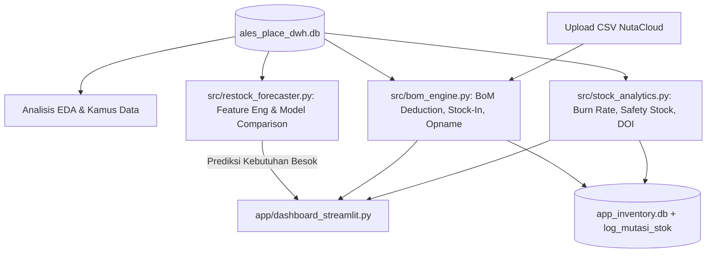

# 🚀 Rencana Kerja Minggu 2: Algoritma Stok, Model Prediksi & Prototipe Dasbor
**Periode Target:** 27 November – 3 Desember 2026  
**Tim Capstone:** `A26-CS218` — *Stok Makanan Sudah Habis* (Bidang Data Science: Afdha & Hauzan)  
**Acuan Rubrik:** [CHECKLIST_TECH_STACK_DS.md](file:///d:/0.%20Dokumen%20Kuliah/Semester%205/0.%20Project%20Capstone/CHECKLIST_TECH_STACK_DS.md)  
**Basis Data Input:** [inventory_resto.db](file:///d:/0.%20Dokumen%20Kuliah/Semester%205/0.%20Project%20Capstone/processed_data/data_bahan_makanan/inventory_resto.db) & [ales_place_dwh.db](file:///d:/0.%20Dokumen%20Kuliah/Semester%205/0.%20Project%20Capstone/processed_data/data_penjualan/ales_place_dwh.db)

---

## 1. Sasaran Minggu 2 (Jadwal Kerja + Rubrik Tech Stack DS)

Menggabungkan target resmi **Minggu 2 (Poin #2)** dengan item wajib pada **Checklist Tech Stack Data Science**:
1. **Dokumentasi & Penyediaan Data untuk Tim Lain (`Data Science #6`, `Penyediaan Data AI #1, #3`):** Menyusun **Kamus Data (*Data Dictionary*)** serta menyepakati format data JSON bersama tim Full-stack & Gen AI (dengan pelabelan eksplisit untuk data primer vs data stok simulasi).
2. **Analisis Bisnis & EDA Operasional (`Data Science #4, #5`):** Mengolah data penjualan & pemakaian bahan historis (13 bulan) untuk menjawab pertanyaan bisnis utama (bahan paling cepat habis, pola *weekday* vs *weekend*, jam sibuk) dan merangkum rekomendasi.
3. **Modul Python *BoM Stock Deduction* & *Inventory Ledger*:** Pemotongan stok otomatis dari input kasir NutaCloud, *Stock-In* pembelian kemasan, serta *Stock Opname* validasi fisik malam hari.
4. **Modul *Daily Burn Rate*, *Safety Stock*, & *Days of Inventory (DOI)*:** Perhitungan laju pemakaian harian historis, batas kritis stok, dan estimasi sisa umur stok.
5. **Model Prediksi Rekomendasi *Restock* Besok (`Penyediaan Data AI #2, #4` & `Model Prediksi #1–#4`):**
   - *Feature engineering* deret waktu (*lag*, *rolling*, *weekend*, *payday*, *ramadan*).
   - *Time-based split* murni tanpa *data leakage* (Train: Okt 2025–Sep 2026; Out-of-time Test: Okt 2026).
   - **Komparasi $\ge 2$ model** (e.g. *Seasonal Weekday/Weekend Baseline*, *Ridge Regression*, *Random Forest / LightGBM*) lengkap dengan evaluasi efek *feature engineering* (MAE, RMSE, WAPE/sMAPE) dan penjelasan keterbatasan model.
6. **Prototipe Dasbor Interaktif Streamlit (`Dasbor #1–#4`):**
   - Menampilkan KPI stok *real-time*, indikator `AMAN / MENIPIS / KRITIS`, *DOI*, rekomendasi belanja besok, dan filter kategori/tanggal.
   - Menyediakan pembaruan data melalui **unggah file CSV NutaCloud (`st.file_uploader`)** maupun **koneksi ke database SQLite**.

---

## 2. Arsitektur Modul & Alur Data Minggu 2

---

## 3. Rincian Deliverable & Struktur Kode

### 🔹 Deliverable 1: Kamus Data & Laporan Analisis Bisnis (`tugas_mingguan/minggu-2/`)
- **`DATA_DICTIONARY.md`:** Penjelasan lengkap setiap tabel & kolom di `processed_data/` (`data_bahan_makanan` & `data_penjualan`), tipe data, relasi FK, batasan data (gap resep 2018 = 59% volume, label stok simulasi), serta contoh query untuk tim Full-stack & Gen AI.
- **`EDA_INSIGHT_OPERASIONAL.md` + `scripts/analyze_burn_rate.py`:** Menjawab pertanyaan bisnis (top bahan baku paling cepat habis, perbandingan konsumsi *weekday* vs *weekend*, dampak transaksi internal `CREW`/`OWNER` terhadap stok, dan temuan operasional).

### 🔹 Deliverable 2: Modul *BoM Stock Deduction* (`src/bom_engine.py`)
- Menggunakan database kerja `processed_data/app_inventory.db` (disalin dari master + ditambah tabel `log_mutasi_stok` dan kolom `lead_time_hari`, `service_level_z`, `is_simulated_stock`).
- Fungsi inti:
  - `deduct_from_sales(items, source_ref)` — Potong stok atomik via `map_menu_kasir` $\rightarrow$ `fact_resep_bom`, mengembalikan rincian bahan terpotong + daftar `unmapped_warnings`.
  - `stock_in_purchase(id_bahan, jumlah_kemasan, catatan)` — Konversi otomatis `jumlah_kemasan * isi_kemasan_beli`.
  - `stock_opname(id_bahan, stok_fisik_aktual, catatan)` — Validasi fisik malam hari & pencatatan selisih (*variance*).
  - `seed_simulated_initial_stock(days=7)` — Mengisi saldo awal simulasi (diberi label `is_simulated_stock=1`) sebelum data fisik aktual Pak Ares diterima.

### 🔹 Deliverable 3: Modul *Safety Stock*, *DOI* & Model Prediksi *Restock* (`src/stock_analytics.py` & `src/restock_forecaster.py`)
- **Statistik Stok (`stock_analytics.py`):**
  - Menghitung $\mu_{\text{daily}}$ & $\sigma_{\text{daily}}$ pada **395 hari operasional aktif** (dengan `0` diisi pada hari aktif di mana suatu bahan tidak terjual).
  - $\text{Safety Stock} = Z \times \sigma_{\text{daily}} \times \sqrt{\text{Lead Time}}$
  - $\text{ROP} = (\mu_{\text{daily}} \times \text{Lead Time}) + \text{Safety Stock}$
  - $\text{DOI} = \frac{\text{stok\_saat\_ini}}{\mu_{\text{daily}}}$ $\rightarrow$ Status `KRITIS`, `MENIPIS`, `AMAN`.
- **Model Forecasting Kebutuhan Besok (`restock_forecaster.py`):**
  - **Anti-Leakage Split:** Train (`2025-10-01` s.d. `2026-09-30`) vs Out-of-time Test (`2026-10-01` s.d. `2026-10-31`).
  - **Eksperimen Feature Engineering:** Mengevaluasi model *sebelum* dan *sesudah* fitur `day_of_week`, `is_weekend`, `is_payday`, `lag_1`, `lag_7`, `rolling_mean_7`, `rolling_mean_28`.
  - **Komparasi Model ($\ge 3$ Model):**
    1. *Seasonal Day-of-Week Baseline* (rata-rata hari yang sama 4 minggu terakhir)
    2. *Ridge Regression* (dengan fitur kalender & lag)
    3. *Random Forest / LightGBM Regressor*
  - Menyimpan hasil evaluasi komparasi (MAE, RMSE, WAPE/sMAPE) + catatan keterbatasan model ke `tugas_mingguan/minggu-2/EVALUASI_MODEL_FORECASTING.md`.
  - Menghitung rekomendasi belanja besok: $\max(0, \hat{y}_{\text{besok}} + \text{Safety Stock} - \text{Stok Saat Ini})$ dalam satuan dasar dan kemasan beli.

### 🔹 Deliverable 4: Prototipe Dasbor Interaktif Streamlit (`app/dashboard_streamlit.py`)
Memenuhi 100% kriteria rubrik **Dasbor untuk Memantau Bisnis**:
1. **Tab 1 — Monitoring Stok Real-Time & Alert:** KPI ringkasan, filter kategori vendor/status (`KRITIS`/`MENIPIS`/`AMAN`), indikator visual warna, *DOI*, & *Daily Burn Rate*, plus banner penanda jelas jika masih memakai *saldo awal simulasi*.
2. **Tab 2 — Upload Laporan NutaCloud & Simulasi Kasir:** Fitur `st.file_uploader` CSV NutaCloud (atau input transaksi manual / *replay* hari tertentu) untuk langsung menjalankan pemotongan stok otomatis dan melihat *log mutasi*.
3. **Tab 3 — Stock Opname Malam & Pembelian Masuk:** Form input stok fisik aktual gudang (hitung *variance*) & input pembelian per kemasan.
4. **Tab 4 — Rekomendasi Belanja Besok & Evaluasi Model:** Tabel daftar belanja prioritas esok hari (siap unduh CSV), grafik tren pemakaian bahan baku, serta ringkasan akurasi perbandingan model prediksi.

### 🔹 Deliverable 5: Unit Tests & Audit Minggu 2
- `tests/test_minggu2.py`: Pengujian otomatis *BoM deduction*, *stock-in*, *opname*, *Safety Stock/DOI*, dan *no-leakage forecast pipeline*.
- `verifikasi/varifikasi-tugas-minggu-2.md`: Laporan verifikasi akhir Minggu 2 pada 3 Desember 2026.

---

## 4. Jadwal Harian Minggu 2 (27 Nov – 3 Des 2026)

| Hari / Tanggal | Fokus Pengerjaan | Acuan Rubrik yang Dipenuhi |
| :--- | :--- | :--- |
| **Hari 1–2** *(27–28 Nov)* | Kamus Data (`DATA_DICTIONARY.md`), Analisis Bisnis/EDA (`EDA_INSIGHT_OPERASIONAL.md`), serta modul `src/bom_engine.py` + `app_inventory.db` + unit test | DS #4, #5, #6; AI #3 |
| **Hari 3–4** *(29–30 Nov)* | Modul `src/stock_analytics.py` + `src/restock_forecaster.py` (feature engineering, no-leakage split, komparasi 3 model, evaluasi metrik & keterbatasan) | AI #2, #4; Prediksi #1, #2, #3, #4 |
| **Hari 5–6** *(1–2 Des)* | Prototipe Dasbor **Streamlit** (`app/dashboard_streamlit.py`) lengkap dengan filter, indikator, `file_uploader`, & simulasi opname/kasir + kesepakatan format JSON dengan tim Full-stack & Gen AI | Dasbor #1, #2, #3, #4; AI #1 |
| **Hari 7** *(3 Des)* | Evaluasi tim, pengecekan akhir, penyusunan `verifikasi/varifikasi-tugas-minggu-2.md`, update `PROGRESS_MINGGUAN.md` & `CHECKLIST_TECH_STACK_DS.md`, dan push GitHub | DS #7 (parsial M2) |
