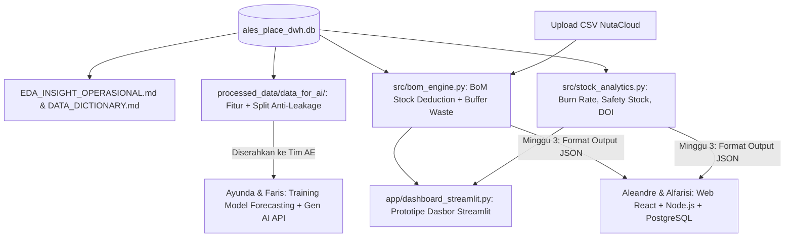

# 🚀 Rencana Kerja Minggu 2: Algoritma BoM & Safety Stock, Paket Data AI, & Dasbor Streamlit
**Periode Target:** 27 November – 3 Desember 2026  
**Tim Capstone:** `A26-CS218` — *Stok Makanan Sudah Habis* (Bidang Data Science: Afdha & Hauzan)  
**Acuan Resmi:** [Project Plan A26-CS218] & [CHECKLIST_TECH_STACK_DS.md](file:///d:/0.%20Dokumen%20Kuliah/Semester%205/0.%20Project%20Capstone/CHECKLIST_TECH_STACK_DS.md)  
**Basis Data Input:** [inventory_resto.db](file:///d:/0.%20Dokumen%20Kuliah/Semester%205/0.%20Project%20Capstone/tugas_mingguan/minggu-1/output/data_bahan_makanan/inventory_resto.db) & [ales_place_dwh.db](file:///d:/0.%20Dokumen%20Kuliah/Semester%205/0.%20Project%20Capstone/tugas_mingguan/minggu-1/output/data_penjualan/ales_place_dwh.db)

> [!IMPORTANT]
> **Penegasan Batas Scope Resmi (Sesuai Project Plan A26-CS218):**
> - **Data Science (`DS` — Afdha & Hauzan):** EDA & analisis bisnis, Kamus Data, **penyediaan dataset siap-AI** (*feature engineering* + *train/test split* anti-leakage + label data primer/simulasi) **untuk dipakai tim AE**, modul Python **`BoM Stock Deduction`** (termasuk *buffer* margin waste), **`Daily Burn Rate` / `Safety Stock` / `Days of Inventory (DOI)`**, serta **prototipe dasbor Streamlit**.
> - **AI Engineer (`AE` — Ayunda & Faris — DI LUAR SCOPE DS):** Melatih & membandingkan **model ML *forecasting* prediksi stok besok**, membangun *REST API inference*, serta fitur **Generative AI explanation** (*ChatGPT/Gemini API*).
> - **Full-stack (`FS` — Aleandre & Alfarisi — DI LUAR SCOPE DS):** Web utama (`React + Vite`), backend (`Node.js`), database (`PostgreSQL`), replikasi aplikasi kasir NutaCloud, CRUD stok web, & *deployment*.

---

## 1. Sasaran Minggu 2 (Jadwal Poin #2 + Checklist DS Bagian 1–3)

1. **Analisis Bisnis / EDA & Kamus Data (`Data Science #4, #5, #6` & `Penyediaan Data AI #3`):**
   - Mengolah data historis 13 bulan untuk menjawab pertanyaan bisnis operasional (*Daily Burn Rate*, pola *weekday* vs *weekend*, top bahan paling cepat habis, dampak transaksi internal `CREW`/`OWNER`) dalam `docs/EDA_INSIGHT_OPERASIONAL.md`.
   - Menyusun `docs/DATA_DICTIONARY.md` yang mendokumentasikan seluruh tabel `output/` dan cara pemakaiannya untuk tim **FS** (`PostgreSQL`/`Node.js`) dan **AE**.
2. **Paket Data Siap-AI untuk Tim AE (`Penyediaan Data AI #1, #2, #4`):**
   - Menyiapkan dataset deret waktu pemakaian bahan baku harian (`395` hari operasional aktif + kalender penuh `396` hari) di `output/data_for_ai/` berisi fitur kalender, lag, rolling, pelabelan sumber data primer vs simulasi, serta **pembagian *train/test* berbasis waktu tanpa *data leakage*** (`train`: Okt 2025 – Sep 2026; `test`: Okt 2026) agar **tim AE (Ayunda & Faris)** langsung bisa melatih & menguji model *forecasting* mereka.
3. **Modul Python *BoM Stock Deduction* (`src/bom_engine.py` — Jadwal Minggu 2 & Risiko Hal. 10):**
   - Konversi rekap penjualan harian NutaCloud $\rightarrow$ pengurangan stok bahan baku via `map_menu_kasir` + `fact_resep_bom`.
   - Memperhitungkan **margin toleransi (*buffer percentage*)** untuk mengantisipasi bahan tercecer/*waste* di dapur (sesuai mitigasi risiko DS pada Project Plan halaman 10).
   - Mendukung pencatatan simulasi saldo stok awal (berlabel eksplisit `is_simulated_stock = 1`), konversi pembelian per kemasan (`isi_kemasan_beli`), dan pengecekan *variance* *stock opname*.
4. **Modul Python *Daily Burn Rate*, *Safety Stock*, & *Days of Inventory* (`src/stock_analytics.py` — Tabel Fitur DS & Jadwal Minggu 2):**
   - Menghitung $\mu_{\text{daily}}$ dan $\sigma_{\text{daily}}$ per bahan baku dari data historis (dibedakan keseluruhan, 30 hari terakhir, *weekday* vs *weekend*).
   - Menghitung ***Safety Stock*** ($Z \times \sigma_{\text{daily}} \times \sqrt{\text{Lead Time}}$), ***Reorder Point (ROP)***, dan ***Days of Inventory (DOI)*** ($\frac{\text{Stok Saat Ini}}{\mu_{\text{daily}}}$).
   - Menentukan status indikator visual: 🔴 **`KRITIS`**, 🟡 **`MENIPIS`**, 🟢 **`AMAN`**.
5. **Prototipe Dasbor Monitoring Stok Berbasis Streamlit (`app/dashboard_streamlit.py` — Dasbor #1–#4):**
   - Menampilkan ringkasan total stok, *Daily Burn Rate*, *DOI*, dan peringatan visual stok menipis/kritis.
   - Menyediakan filter kategori vendor/status/tanggal yang relevan.
   - Menyediakan fitur **unggah file CSV NutaCloud (`st.file_uploader`)** maupun **koneksi ke SQLite** untuk simulasi pembaruan & pemotongan stok harian, disertai label jelas untuk saldo stok simulasi awal.

---

## 2. Alur Kerja & Batas Tegas DS $\rightarrow$ AE & FS

---

## 3. Jadwal Harian Minggu 2 (27 Nov – 3 Des 2026)

| Hari / Tanggal | Fokus Pengerjaan (Strictly Scope DS) | Acuan Checklist / Project Plan |
| :--- | :--- | :--- |
| **Hari 1–2** *(27–28 Nov)* | Menyusun `DATA_DICTIONARY.md`, analisis bisnis `EDA_INSIGHT_OPERASIONAL.md`, & membangun `processed_data/data_for_ai/` (*feature engineering* + *train/test split* anti-leakage + kesepakatan format dengan AE) | DS #4, #5, #6; AI #1, #2, #3, #4 |
| **Hari 3–4** *(29–30 Nov)* | Membangun `src/bom_engine.py` (*BoM Deduction* + *buffer* waste + simulasi stok awal berlabel) & `src/stock_analytics.py` (*Daily Burn Rate*, *Safety Stock*, *ROP*, *DOI*) + unit test | Project Plan M2 #2, Risiko Hal. 10; Dasbor #4 |
| **Hari 5–6** *(1–2 Des)* | Membangun prototipe dasbor **Streamlit** (`app/dashboard_streamlit.py`) dengan KPI, filter, indikator visual, `st.file_uploader` CSV NutaCloud, & simulasi pemotongan stok | Dasbor #1, #2, #3, #4; Project Plan Hal. 3 |
| **Hari 7** *(3 Des)* | Pengecekan ketepatan modul & angka analisis, penyusunan `verifikasi/varifikasi-tugas-minggu-2.md`, update `PROGRESS_MINGGUAN.md` & `CHECKLIST_TECH_STACK_DS.md`, dan push GitHub | DS #7 (parsial M2) |
